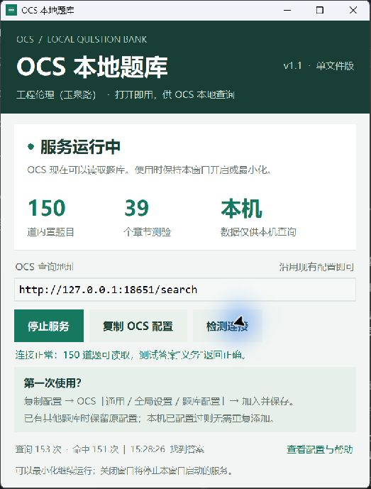

# OCS 本地题库

一个带中文界面的 Windows 本地题库服务。双击单个 EXE 后，OCS 可以通过本机 HTTP 接口查询内置答案。

当前版本 **v1.1.0**，内置工程伦理（玉泉路）39 个章节测验、150 道题。程序、题库、Python 与 Tk 运行组件都已打包；使用发布版无需安装 Python，也无需在 EXE 旁边放置 JSON 文件。

**[下载 Windows 单文件版](https://github.com/mrunderstand666/ocs-local-question-bank/releases/latest)** · **[版本说明](CHANGELOG.md)** · **[测试记录](validation.json)**



## 目录

- [快速开始](#快速开始)
- [界面功能](#界面功能)
- [接入 OCS](#接入-ocs)
- [题库内容与匹配规则](#题库内容与匹配规则)
- [HTTP 接口](#http-接口)
- [从源码运行](#从源码运行)
- [构建单文件 EXE](#构建单文件-exe)
- [更换题库](#更换题库)
- [测试与验证范围](#测试与验证范围)
- [常见问题](#常见问题)
- [项目结构与许可](#项目结构与许可)

## 快速开始

1. 在 [Releases](https://github.com/mrunderstand666/ocs-local-question-bank/releases) 下载 `OCS-Local-Question-Bank-v1.1.0-windows-x64.exe`。
2. 双击运行，稍等内置组件解压及服务启动。界面显示绿色的“服务运行中”后即可使用。
3. 已配置过 `http://127.0.0.1:18651/search` 的 OCS 可继续使用；第一次使用时点击“复制 OCS 配置”，按下文添加。
4. 使用 OCS 时保持程序运行，可以最小化。点击“停止服务”或确认退出会停止查询接口。

发布文件只需保存这一个 EXE。程序没有安装步骤，不添加开机启动，也不要求管理员权限。单文件启动时，PyInstaller 会把运行组件临时解压到系统临时目录；这不要求用户额外分发这些文件。

### 文件校验

Release 同时提供 `SHA256SUMS.txt`。在 PowerShell 中运行：

```powershell
Get-FileHash .\OCS-Local-Question-Bank-v1.1.0-windows-x64.exe -Algorithm SHA256
```

将输出与校验文件对应行比较。v1.1.0 发布 EXE 为 12,878,854 字节。当前二进制未做代码签名。

## 界面功能

| 功能 | 行为 |
| --- | --- |
| 自动启动 | 打开窗口后加载内置题库并监听本机 18651 端口 |
| 启动／停止服务 | 在同一窗口中控制服务，停止后可以重新启动 |
| 复制 OCS 配置 | 将完整 JSON 配置复制到剪贴板 |
| 检测连接 | 请求健康检查和一道真实题目，核对返回答案“义务” |
| 查询统计 | 显示本次运行的请求数、命中数、最近查询时间与结果 |
| 配置与帮助 | 展示配置内容和接入步骤 |
| 退出提醒 | 提醒退出会中断查询，确认后释放服务端口 |
| 端口占用提示 | 已有服务或端口冲突时给出提示，不结束其他进程 |

查询统计在内存中保存，重启程序后归零。程序不会把查询过程写成历史答题记录。“检测连接”也会产生一次查询，所以计数不等同于 OCS 的实际答题数量。

## 接入 OCS

### 第一次配置

1. 启动本程序，确认显示“服务运行中”。
2. 点击“复制 OCS 配置”。
3. 在 OCS 面板进入“通用 → 全局设置 → 题库配置”（不同版本的名称可能略有不同）。
4. 只有本题库时可粘贴完整数组；已有其他题库时，把下面的对象追加到原有数组中，保留其他配置，注意逗号和方括号。
5. 保存配置，按 OCS 页面提示完成对本机地址的访问授权，再执行连接检查。

```json
[
  {
    "name": "工程伦理（玉泉路）个人作答题库",
    "homepage": "http://127.0.0.1:18651/",
    "url": "http://127.0.0.1:18651/search",
    "method": "get",
    "contentType": "json",
    "type": "GM_xmlhttpRequest",
    "data": {
      "title": "${title}",
      "type": "${type}",
      "options": "${options}"
    },
    "handler": "return (res) => res.code === 1 ? res.results.map(r => [r.question, r.answer]) : undefined"
  }
]
```

配置采用 OCS 的 AnswererWrapper 结构。`GM_xmlhttpRequest` 用于脚本跨域请求；脚本管理器需要允许访问 `127.0.0.1`。如果出现域名权限提示，请核对目标是本机地址。可参考 [OCS 官方开发文档](https://docs.ocsjs.com/docs/other/api) 中的题库配置和 `@connect` 说明。

OCS 必须与本 EXE 运行在同一台电脑上；另一台电脑访问自己的 `127.0.0.1` 不会连接到本机。服务只监听回环地址，没有对局域网或互联网开放。

### 如何核验实际自动搜题

本程序的“检测连接”验证本地服务，不能替代 OCS 在课程页面中的自动识题测试。验证完整流程时：

1. 选择允许练习且能进入答题状态的页面，确认 OCS 已识别题目。
2. 在测试期间避免缓存或其他题库干扰；按需临时关闭其查询，并记录原设置。
3. 检查 OCS 完成后的行为，避免自动提交或自动跳转影响现有作答。
4. 从 OCS 的作业／测验自动搜题入口启动流程，不使用手动输入题干代替。
5. 在结果明细中检查来源为“工程伦理（玉泉路）个人作答题库”、题目与答案正确、搜题进度已完成，同时观察本程序查询计数变化。
6. 测试结束后恢复临时调整的 OCS 设置。

仅看到“连接成功”、历史答案或手动搜索结果，不能证明自动识题流程已通过。

## 题库内容与匹配规则

| 题型 | 数量 | 内部类型 |
| --- | ---: | --- |
| 单选题 | 71 | `single` |
| 多选题 | 36 | `multiple` |
| 判断题 | 17 | `judgement` |
| 填空题 | 26 | `completion` |
| 合计 | **150** | |

数据文件为 `seed.json`，包含最终整理后的问题、选项、答案和章节信息，不包含历史作答列表、课程登录链接或浏览器凭据。它是一份个人整理题库，不是课程平台发布的官方标准答案；来源标记用于记录整理过程，不能独立证明每道题的正确性。

匹配策略：

- 对题干进行 Unicode NFKC 规范化，处理开头的题型标签、题号与末尾分值，并忽略非字母数字字符。
- 使用规范化后的题干精确匹配；不做语义检索或模糊猜答。
- 调用方提供有效题型时按题型筛选。
- 提供选项时比较选项文本集合，支持 `A.`、`A、` 等常见前缀和选项乱序。
- `undefined`、`null` 以及未替换的选项占位符按空选项处理，兼容 OCS 的部分请求形式。
- 同题干但题型、选项或答案有歧义时返回未命中，要求提供更多题目信息。
- 多选和多空答案采用 `#` 分隔；选择题返回选项文本，方便 OCS 根据当前顺序匹配。

## HTTP 接口

默认基础地址：`http://127.0.0.1:18651`。接口无账号登录，只供本机只读查询；没有添加、修改或删除题目的 HTTP 入口。

| 方法 | 路径 | 用途 |
| --- | --- | --- |
| GET / HEAD | `/health` | 服务标识、版本、题量和可查询数量 |
| GET / HEAD | `/`、`/index.html` | 同健康检查 |
| GET / HEAD | `/search` | 题干、题型与选项查询 |
| GET / HEAD | `/ocs-config` | 返回当前端口对应的 OCS 配置数组 |

`HEAD` 返回相应状态码和头部，不返回正文。未知路径返回 404；非本机 Host 请求被拒绝。此限制不等同于身份认证，本机程序仍可访问服务。

### 请求参数

| 参数 | 必需 | 说明 |
| --- | --- | --- |
| `title` | 是 | 完整题干，使用 URL 编码 |
| `type` | 否 | `single` / `multiple` / `judgement` / `completion` |
| `options` | 否 | 换行分隔的完整选项，建议包含选项文本 |

```python
import json
from urllib.parse import urlencode
from urllib.request import ProxyHandler, build_opener

query = urlencode({
    "title": "伦理是处理人与人、人与社会、( )相互关系时应遵循的道理和准则。",
    "type": "single"
})
with build_opener(ProxyHandler({})).open(
    "http://127.0.0.1:18651/search?" + query, timeout=5
) as response:
    print(json.load(response))
```

命中响应示意：

```json
{
  "code": 1,
  "msg": "找到匹配答案",
  "results": [
    {
      "id": "53463",
      "question": "伦理是处理人与人、人与社会、( )相互关系时应遵循的道理和准则。",
      "answer": "人与自然",
      "chapter": "1.1.1",
      "answer_source": "graded_answer"
    }
  ]
}
```

无匹配或题干歧义时，返回 `code: 0` 和空的 `results`，不会凭空生成答案。

## 从源码运行

主要运行代码只使用 Python 标准库，包括 Tkinter、HTTP 服务和 JSON 处理。开发环境需要 Python 及可用的 Tcl/Tk。v1.1.0 在 Windows 11 x64、Python 3.13.9 / Tk 8.6 环境验证。

```powershell
git clone https://github.com/mrunderstand666/ocs-local-question-bank.git
cd ocs-local-question-bank
python gui.py
```

如使用源码启动纯命令行服务：

```powershell
python bank_server.py --check
python bank_server.py --bank .\seed.json --port 18651
```

GUI 默认使用随源码或 EXE 内置的 `seed.json`。`--bank`、`--port` 和 `--check` 属于命令行服务 `bank_server.py`，不是 GUI EXE 的参数。命令行版本在 Windows 可通过另一个终端运行 `python bank_server.py --stop --port 18651` 停止；GUI 服务请使用窗口按钮停止。

## 构建单文件 EXE

在 Windows x64 中构建 Windows 发布版。使用带 Tkinter 的 Python：

```powershell
.\build.ps1 -Python python
```

构建脚本将创建项目专用的 `.venv-build`，安装 `requirements-build.txt` 中固定版本的 PyInstaller 和 hooks，使用相对项目路径构建。输出：

```text
dist/OCS本地题库.exe
```

也可以手动执行：

```powershell
python -m venv .venv-build
.\.venv-build\Scripts\python.exe -m pip install -r requirements-build.txt
.\.venv-build\Scripts\python.exe -m PyInstaller --noconfirm OCSLocalBank.spec
```

配置采用 `onefile` + `windowed`，双击后显示图形窗口。EXE 内嵌 `seed.json`。构建结果与 Python 版本、依赖和打包环境有关，重新构建不保证得到与 Release 完全相同的二进制哈希。

## 更换题库

编辑 `seed.json` 后重新构建即可更新内置数据。每条题目至少应包含：

```json
{
  "id": "example-001",
  "question": "这里填写完整题干",
  "type": "single",
  "options": [
    {"label": "A", "text": "选项一"},
    {"label": "B", "text": "选项二"}
  ],
  "answer": "选项一",
  "chapter": "示例章节"
}
```

外层结构为 `{"metadata": {}, "questions": [...]}`。`id` 必须非空且唯一；选项为空的题目仍使用 `"options": []`。可先运行 `python bank_server.py --bank .\seed.json --check` 检查格式。

当前 GUI 的课程名称、配置名称和连接诊断样例针对内置工程伦理题库。换成其他课程时，需要同步修改 `gui.py` 中课程标题和 `check_connection()` 的测试题，以及 `bank_server.py` 的配置名称。诊断目前使用 ID `53546`；删除该题而不调整诊断会导致“检测连接”失败，其他有效题目查询不受该诊断逻辑影响。

## 测试与验证范围

运行源码测试：

```powershell
python -m unittest -v test_bank.py
```

测试会在随机回环端口启动临时服务，不依赖正在运行的 18651 服务，也不改动课程页面。覆盖全部 150 条题目的真实 HTTP 查询、无匹配响应、选项过滤、歧义保护、配置生成、HEAD 和 Host 检查。

v1.1.0 发布前已完成：

| 检查项 | 结果 |
| --- | --- |
| 打包 EXE 实际启动、健康接口 | 通过 |
| EXE 返回 150 条题目的答案与整理题库逐一一致 | 150 / 150 |
| 题库数据与本地确认版本一致 | 通过 |
| 无匹配题目返回空结果 | 通过 |
| OCS 配置 JSON、HEAD 请求兼容 | 通过 |
| 剪贴板配置内容校验 | 通过 |
| 连接按钮实际查询并核对“义务” | 通过 |
| GUI 停止、重启、退出释放端口 | 通过 |
| 帮助窗口和退出提醒实机检查 | 通过 |
| 仅系统目录 PATH 下启动 EXE | 通过 |
| 新版 GUI EXE 的浏览器实际自动搜题全流程 | **未完成验证** |

最后一项测试在完成前停止，因此本项目不把接口检查或旧服务的测试结果当作新版 EXE 自动搜题全流程通过的证据。150 / 150 指返回内容与整理数据一致，不表示对每道题做了独立学术正确性审查。

## 常见问题

### OCS 提示连接失败

确认 EXE 显示“服务运行中”，地址是 `http://127.0.0.1:18651/search`，浏览器与 EXE 在同一电脑。先用“检测连接”确认服务，再检查 OCS 的配置是否保存、脚本管理器是否允许访问本机地址。不要把 JSON 中的 `GM_xmlhttpRequest` 随意改成普通 `fetch`。

### 为什么显示“已有题库服务运行”或端口占用？

同一端口只能由一个服务监听。已打开旧版或另一个窗口时，先正常关闭原服务，再在新窗口重试。程序不会强制停止其他进程。GUI 固定使用 18651；开发者需要其他端口时可使用命令行服务并同步调整 OCS 配置。

### 为什么有题目但没有返回答案？

题目可能不在这 150 道中；题干有实质性差异；选项缺失、重复或不同；或者同题干存在歧义。服务选择返回未命中，避免把不同题目错误匹配。

### 程序能独立操作课程网站吗？

不能。它只提供本地题库查询服务。网页题目识别、选项匹配、填写、保存或提交由 OCS 及课程平台控制，请在对应软件中核对这些行为。

### 能直接在 EXE 旁边放一个题库文件来更新吗？

当前 GUI 版本始终读取内置数据，不会自动读取旁边的 JSON。修改源码中的 `seed.json` 并重新打包，或者用命令行服务的 `--bank` 指定外部文件。

### 关闭窗口后为什么不能查询？

服务随窗口退出而停止。需要持续查询时请最小化，重启电脑后需再次打开程序。

### 是否支持 macOS / Linux？

发布附件只提供 Windows x64 EXE。Python 服务核心主要使用标准库，但其他系统的 GUI、打包和使用体验未做验证。

## 项目结构与许可

```text
gui.py                  中文 GUI、服务生命周期、配置复制与连接诊断
bank_server.py          题目规范化、匹配逻辑、HTTP 接口、命令行入口
seed.json               内置题库
test_bank.py            独立回环 HTTP 测试
OCSLocalBank.spec       可迁移的 PyInstaller 配置
build.ps1              Windows 构建入口
requirements-build.txt 打包依赖版本
validation.json        已发布 EXE 的验证结果和校验值
screenshot.png         实际界面截图
CHANGELOG.md           版本记录
LICENSE                MIT 代码许可证
```

本仓库原创程序代码按 [MIT License](LICENSE) 开源。该许可不授予第三方课程材料、题目文本或 OCS 自身的知识产权；数据使用及再分发应遵守其原有权利和使用条件。本项目是独立的本地服务，与 OCS 官方及课程平台无隶属关系。

问题反馈时请提供软件版本、界面提示和脱敏后的请求示例；不要上传 Cookie、课程登录链接、账号口令或其他题库的密钥。
